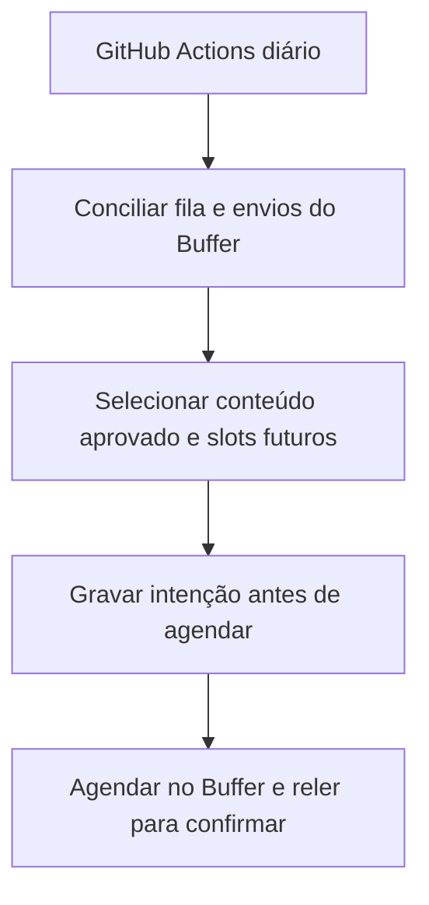

# LinkedIn worker — Guilherme Molina Solano

Worker diário em GitHub Actions para manter três publicações por dia no LinkedIn, com fontes e imagens. Publica apenas o catálogo aprovado, sem chamar a API OpenAI. Após o catálogo acabar, novos lotes aprovados serão necessários para manter três publicações por dia. Os 10 agendamentos existentes são migrados pelo seed, sem reenviar.

## Arquitetura

## Ativação

O workflow fica em `.github/workflows/linkedin-worker.yml`; código em `linkedin-worker/`. Em [Repository secrets](https://github.com/MolinaGG/guilherme-molina-portfolio/settings/secrets/actions), crie:

| Secret | Valor |
|---|---|
| BUFFER_API_KEY | Chave da sua conta Buffer já conectada ao LinkedIn |

O `GITHUB_TOKEN` é fornecido pelo próprio Actions, não precisa criar PAT. Não publique chaves em arquivos, commits, issues, screenshots ou chat.

Depois acesse [Actions / LinkedIn worker](https://github.com/MolinaGG/guilherme-molina-portfolio/actions/workflows/linkedin-worker.yml), clique **Run workflow**, branch **main**, e acompanhe o job **publish**. Push de código do worker executa apenas a validação, inclusive na main. Só o cron e a execução manual na main podem publicar, após os testes. Commits de estado e imagens não acionam o workflow. Um job verde com `status: ok` e readback confirma a execução. `scheduled: 0` é normal se a fila estiver cheia. O estado persistente fica em `linkedin-worker/runtime/state.json`.

A recorrência é 09:17 UTC (06h17 Brasília), independente do seu PC. Os slots planejados no Buffer são 08h30, 12h30 e 18h. O horário do cron pode atrasar; a fila dá antecedência. GitHub pode desativar agendamentos públicos após 60 dias sem atividade; os commits de estado mantêm atividade durante operação normal, mas confira Actions após pausas longas.

## Configuração opcional por Repository variables

| Variável | Padrão | Finalidade |
|---|---|---|
| LINKEDIN_WORKER_PAUSED |false| true impede novas execuções de publicação |

Para pausar imediatamente, desabilite o workflow ou configure `LINKEDIN_WORKER_PAUSED=true`. Posts já agendados no Buffer continuam; pause também o canal Buffer se quiser interromper entregas. Não execute `publisher.py sync --apply` local nem a antiga tarefa Codex em paralelo ao worker.

## Custos e limites

- O workflow de produção não recebe credencial OpenAI e o comando de produção não habilita a geração paga. Ele pode concluir um lote previamente gerado e já aprovado, sem nova chamada de IA.
- Actions usa runner Linux padrão do GitHub em repositório público. Buffer mantém limite de 10 posts na fila e suas próprias cotas de API. O worker consulta todos os posts não enviados e os enviados nos últimos 7 dias. Reserva cada requisição no histórico e para antes de ultrapassar 900 no mês, deixando margem para uso externo.
- Se não houver conteúdo aprovado, o worker fica sem novos posts para agendar, sem contratar nenhum serviço ou gerar conteúdo novo. A operação depende dos serviços e suas políticas.

## Conteúdo e engajamento

Português direto, sem emojis, sem procura explícita de emprego, sem experiências inventadas. Temas de SQL, Power BI, Python, projetos e decisões de negócio. A pesquisa usa fontes primárias; a revisão independente precisa aprovar texto, pontos da imagem e referências. Isso reduz erros, mas não prova veracidade automaticamente.

O histórico recente orienta diversidade; não há automação de curtidas, comentários, mensagens ou conexões. O arquivo opcional `metrics.csv` recebe dados reais exportados/manualizados do LinkedIn, com `post_id,topic,impressions,comments,shares`. O script de métricas agrega comentários e compartilhamentos por impressão para planejamento editorial. Não há acesso automático a analytics contratado/conectado aqui, e amostras pequenas não provam qual assunto causou alcance.

## Estado e recuperação

- Compare-and-swap de SHA impede sobrescrever estado concorrente. O workflow serializa execuções.
- SQLite é reconstruído em diretório temporário a partir do estado durável. Antes de cada envio, `inflight` já deve estar no GitHub. Após resposta, fica `uncertain` até verificar ID/texto/horário/status.
- Timeout de escrita é ambíguo: nunca reenviar automaticamente. Próxima execução lê o estado e o Buffer. Se continuar incerto, inspecione os registros e a fila antes de resolver manualmente.
- Geração revisada é salva antes de hospedar imagens; uma execução seguinte retoma o lote por até 7 dias. Depois expira, evitando fontes antigas. Imagens usam nomes por hash e não sobrescrevem conteúdo existente.
- O estado ativo conserva os90 iniciais, os180 posts diários enviados mais recentes e todo conteúdo pendente, além de14 dias de auditoria de geração e3 meses de contadores. Versões anteriores continuam no histórico Git. Nenhum arquivo de imagem publicado é removido automaticamente.
- Repositório público: textos planejados e auditorias editoriais ficam públicos; as credenciais ficam somente em Actions secrets. Não inclua dados privados do empregador.
- Após uma interrupção superior a 7 dias, posts podem ter saído da janela de conciliação. Configure a variável `BUFFER_FULL_HISTORY=true`, execute uma recuperação manual e remova a variável após confirmar o estado. Isso consome mais requisições; não habilite permanentemente.
- Não apague `runtime/state.json` para consertar falhas: isso perderia intenções e contadores. `seed.json` serve apenas para primeira inicialização.

## Verificação

`python -m unittest discover -s tests -q` executa testes sem chamadas pagas ou posts reais. O cliente Buffer já agendou e releu 10 posts reais antes desta migração.

Fontes: [GitHub Actions](https://docs.github.com/en/actions/concepts/billing-and-usage), [agendamentos](https://docs.github.com/en/actions/reference/workflows-and-actions/events-that-trigger-workflows#schedule), [Buffer API](https://developers.buffer.com/guides/posts-and-scheduling.html).
